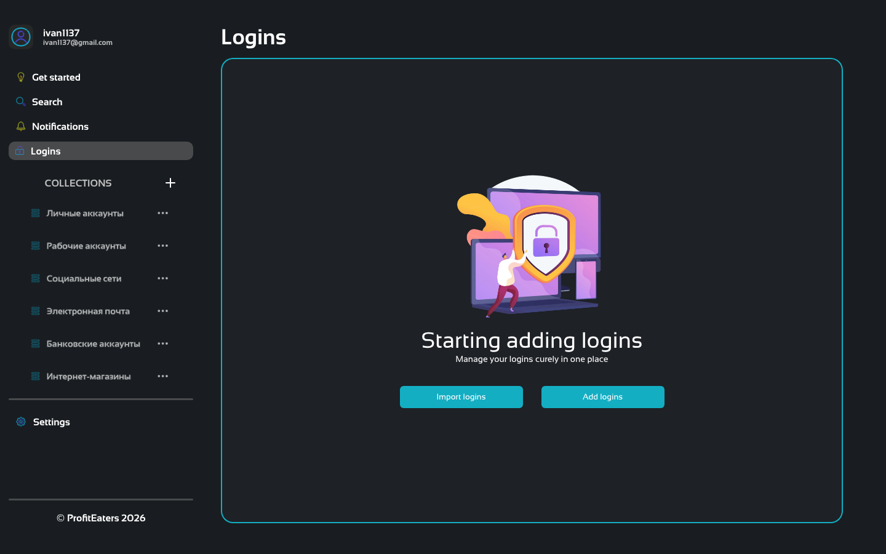
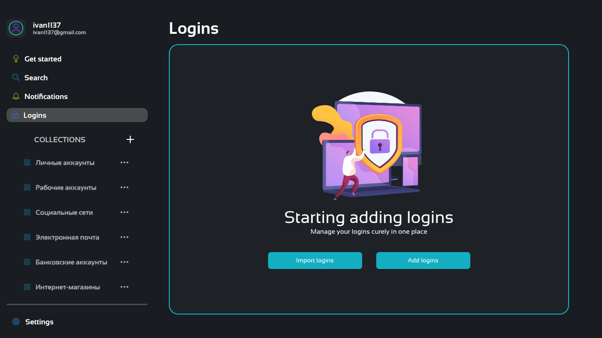
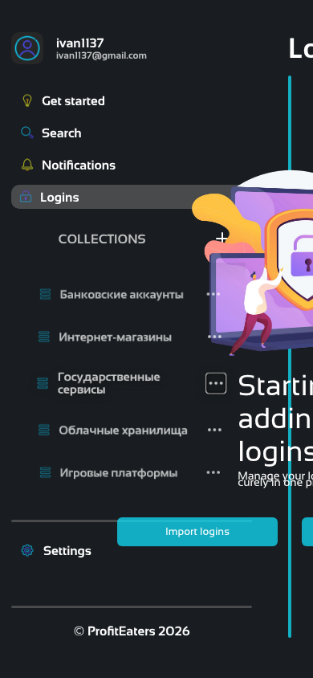
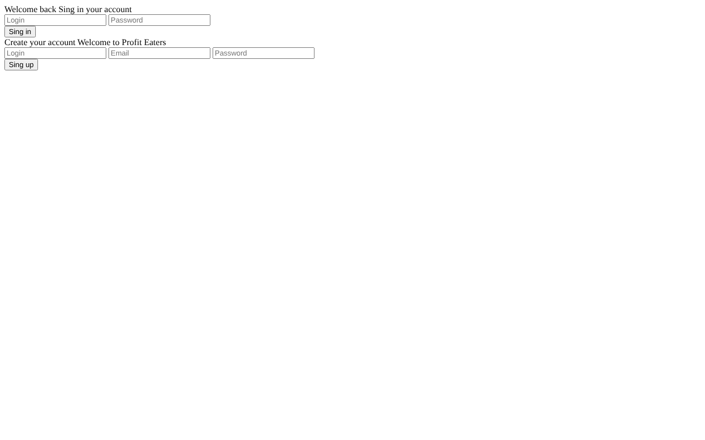

# Аттестация фронтенда — ProfitEaters Password Manager

**Объект:** [g8cx/pass_manager](https://github.com/g8cx/pass_manager), ветка `frontend`, коммит `3ff2966` («Add color variables»). В `main` фронтенда нет, там только Spring-бэкенд.
**Объём:** 2 HTML-страницы, 4 JS-файла (~210 строк), 4 Sass-файла, 1 JSON-заглушка, ассеты.
**Дата:** 10.11.2026

## Как проверялось

| Проверка | Инструмент |
|---|---|
| Чтение всех файлов ветки | вручную |
| Компиляция Sass | dart-sass (последняя версия) |
| Линтинг JS | ESLint 9: `recommended`, `no-redeclare` с builtinGlobals, `no-console` |
| Линтинг HTML / CSS | HTMLHint, Stylelint (правила на валидность) |
| Работа в браузере | Chromium (Playwright): 1440×900, 1280×720, 768×1024, 390×844 |
| Доступность | обход по Tab, расчёт контраста по формуле WCAG 2.1 |
| Сеть | вес шрифтов и изображений, загруженные font-family |

Все проблемы ниже воспроизведены, ни одна не выведена только из чтения кода.

---

## Итог

**Статус: прототип, к интеграции не готов.** Главный экран на десктопе свёрстан аккуратно, визуальная идея понятная. Но CSS не собирается из исходников, один из скриптов ломает глобальный `navigator`, адаптива нет, без мыши интерфейсом не воспользоваться, страница входа не свёрстана, а её форма отправляется небезопасно. С бэкендом фронт не связан.

| Критерий | Оценка (из 5) | Коротко |
|---|:-:|---|
| Структура проекта и сборка | 2 | Sass не компилируется, CSS рассинхронизирован, сборка завязана на Prepros |
| HTML и семантика | 2.5 | нет заголовков, ссылки без `href`, у форм нет label/autocomplete |
| CSS / Sass | 2.5 | невалидный цвет, `* body`, глубокая вложенность, тема на Sass-переменных |
| JavaScript | 2.5 | затирание `navigator`, гонка инициализации, forced reflow |
| Доступность (a11y) | 1.5 | меню и коллекции недоступны с клавиатуры, контраст кнопок 2.67:1 |
| Адаптивность | 1 | ни одного media query, на 390px рабочая область шириной 0px |
| Производительность | 3 | 7 шрифтовых семейств ради одного, PNG 603 КБ |
| Безопасность (фронт) | 2 | GET-форма с паролем, нет CSP, сторонние шрифты |
| Готовность к API | 1 | эндпоинта нет на бэке, CORS нет |
| **Итого** | **≈ 2 / 5** | |

---

## 🔴 Критические проблемы (блокеры)

### 1. Sass не компилируется, закоммиченный CSS устарел
`styles/sass/work_place.sass:24`:
```sass
background-color: v.$workplace-backgound-dark
```
В `_variables.sass` переменная называется по-другому: `$backgound-workplace-dark`. dart-sass падает с `Error: Undefined variable`. Закоммиченный `styles/css/work_place.css` собран из какой-то старой версии: в нём `rgba(33, 37, 41, 0.6)` и акцент `#10E3FFB9`, а в `_variables.sass` этих значений уже нет. Первый же, кто пересоберёт проект, получит ошибку, а после исправления увидит другие цвета.

### 2. Невалидный акцентный цвет
`styles/sass/_variables.sass:13`: `$accent-color-dark: #10E3fFFB9`. Это 9 hex-символов, а допустимо 3, 4, 6 или 8. Sass компилирует его в `background: rgba(16, 227, 255, 0.98) 9;` (`styles/css/sidebar.css:207`), браузер такую декларацию отбрасывает. В итоге у бегунка скролла коллекций нет цвета (проверено через `CSSOM`: свойство пустое).

### 3. `const navigator` подменяет глобальный `window.navigator`
`js/scroll_baraban_effector.js:1`:
```js
const navigator = document.querySelector('.collections_navigation');
```
Скрипты подключены как классические, поэтому у них общий глобальный scope, и это объявление перекрывает встроенный `navigator` **для всех скриптов страницы**. В браузере после загрузки `navigator.clipboard === undefined`. Менеджеру паролей это сломает копирование пароля (`navigator.clipboard.writeText`), а также `navigator.credentials`, `navigator.language` и прочее.
То же самое в `js/scroll_effector.js:2`: `const navigation` перекрывает `window.navigation` (Navigation API). ESLint с `no-redeclare: builtinGlobals` выдаёт на этих строках 2 ошибки.

### 4. Форма входа отправляется GET-запросом
`html/auth.html`: `<form action="">` без `method` и без JS-обработчика. Нажатие «Sing in» перезагружает страницу на `auth.html?` (проверено). Сейчас у полей нет `name`, поэтому данные никуда не уходят. Но как только `name` появится, **логин и пароль попадут в URL**, а значит в историю браузера, логи сервера и заголовок `Referer`.

### 5. Страница авторизации не свёрстана
К `auth.html` не подключено ни одного CSS-файла и ни одного скрипта. Формы входа и регистрации идут друг за другом без переключения. См. [скриншот](auth.png).

---

## 🟠 Существенные проблемы

### JavaScript
- **Гонка инициализации.** `load_collections()` асинхронный, а `scroll_effector.js` и `scroll_baraban_effector.js` выполняются сразу после него, когда списка ещё нет. Замер после `networkidle`: из 20 элементов `--item-scale` выставлен у **0**, у всех `opacity: 0.7`, нижней тени нет, хотя список прокручивается. Эффекты появляются только после первой прокрутки ([скриншот](desktop_initial.png)).
- **Нет пересчёта при `resize`.** Тени и «барабан» не обновляются при изменении размера окна.
- **Forced reflow при каждом scroll.** В `updateWheelEffect` внутри одного цикла чередуются `getBoundingClientRect()` и `style.setProperty()`, и браузер пересчитывает стили на каждой итерации. Вдобавок `[...items].slice(0, 3).includes(item)` вызывается для каждого элемента, это O(n²). Нужен `requestAnimationFrame`, сначала все чтения, потом все записи, а first/last проверять по индексу.
- `console.log(event.target)` срабатывает на каждый клик (`js/switch_collections.js:10`).
- Клик по пунктам меню только переключает подсветку: навигации нет, заголовок «Logins» статичный.
- `li.id = '/collections/col_001'`: маршрут хранится в `id`. Лучше `data-id` и настоящий `href`.
- Стиль кода разный: `load_collections` (snake_case) рядом с `updateWheelEffect` (camelCase), в одном файле отступы 2, 4 и 8 пробелов, остался закомментированный код.
- SVG-иконка собирается вручную на ~30 строк. Проще положить `<template>` в HTML и делать `cloneNode(true)`.
- README упоминает ESLint, но ни конфига, ни `package.json` в репозитории нет.

### HTML, семантика, доступность
- **Навигация с клавиатуры не работает.** Пункты меню и коллекции сделаны на `<a>` без `href`, поэтому в Tab-порядок не попадают. Реальный обход Tab: `+` → `…` → `…` → `…`… Ни один пункт меню и ни одна коллекция фокус не получают.
- **У кнопок-иконок нет имени.** У «+» (добавить коллекцию) и у каждого «…» нет `aria-label`, скринридер прочитает просто «button».
- **Нет заголовков h1–h6.** «Logins» лежит в `<header>`, «Starting adding logins» в `<span class="main_h1">`. Sidebar размечен как `<section>`, хотя по смыслу это `<aside>`/`<nav>`.
- **Контраст кнопок 2.67:1** (белый текст на `rgba(16,227,255,.725)`), а по WCAG AA нужно не меньше 4.5:1. С тёмным текстом `#191D21` получится ≈ 6.4:1.
- **Формы в `auth.html`:** нет `<label>` (5 ошибок HTMLHint), нет `autocomplete="username | current-password | new-password | email"`. Для менеджера паролей это особенно досадно: без этих атрибутов браузеры и сторонние менеджеры не понимают поля. Нет `required`/`minlength`, нет кнопки показа пароля, хотя иконки `eye.svg`/`eye-off.svg` уже лежат в `assets/icons/`, просто не используются.
- Нет стилей `:focus-visible`.
- Стоит `lang="en"`, а названия коллекций на русском. Нужно выбрать язык или сделать i18n.
- **Опечатки в интерфейсе:** «Sing in / Sing up» → *Sign*; «curely» → *securely*; «Starting adding logins» → *Start adding logins*. **Опечатки в коде:** `funtional_btn`, `backgound`, `EFFETCS`.
- `id="active"` и класс `active` на одном элементе путают. Для JS-хука лучше `data-default-tab`.

### CSS / Sass
- В `styles.sass` блоки `body` и `a` вложены в `*`, отсюда селекторы `* body` и `* a`. Работает это по случайности.
- `color` задан на `*`, а не на `body`. Наследование не работает, все `input`/`button` принудительно получают белый текст.
- **Тема на Sass-переменных** собирается в статические значения, переключить её на лету нельзя. Для тёмной и светлой темы нужны CSS custom properties. Светлая тема пока состоит из одной переменной.
- **Сдвиг на 2px у активного пункта.** У `.btn_effects` задан `border: 2px solid transparent`, а `.active` ставит `border: none`. Иконка «Logins» стоит на 22px, остальные на 24px (замер). Надо писать `border-color: transparent`.
- Вложенность до 8 уровней (`.sidebar .main_data .collections .collections_navigation li .collection_content .collection_a .collection_image`): высокая специфичность, переиспользовать нельзя. Лучше БЭМ или плоские классы.
- Дубли: `.settings_line` описан дважды, `.btn_effects` совпадает с `.collection_btn_effects`, `&.active` повторяется трижды. Это стоит вынести в `@mixin`/`%placeholder`.
- `.main_h2 { line-height: 8px }` меньше `font-size: 14px`, при переносе строки текст налезает.
- Стили скроллбара есть только в `::-webkit-scrollbar`. Для Firefox нужны `scrollbar-color`/`scrollbar-width`.
- Префиксы `-ms-flexbox` и `-webkit-box` нужны только для IE10. Стоит задать `browserslist`.

### Адаптивность
- В проекте **нет ни одного media query**. Sidebar фиксированный, 300px, плюс отступы body 14 + 70 и gap 45.
  - 768px: рабочая область сжимается до 339px.
  - 390px: **рабочая область шириной 0px**, горизонтальный скролл до 576px, контент налезает на sidebar ([скриншот](mobile.png)).
- **1280×720 (обычный ноутбук): футер обрезан.** У sidebar низ на 760px при высоте окна 720, а `body { overflow: hidden }` не даёт его прокрутить ([скриншот](laptop_720.png)). Причина в жёстком `max-height: 300px` у списка коллекций.

### Производительность
- **Google Fonts:** подключено 7 семейств (Bricolage Grotesque, Exo 2, Google Sans, Pacifico, Sansation, Space Mono, Valley Sans), используется одно, Sansation. Это 45 КБ CSS, блокирующего рендер, вместо примерно 2 КБ.
- **`add_login.png`:** 990×990, 603 КБ, а показывается 250×250. Это около 95% веса страницы. Нужен SVG или WebP нужного размера.
- Иконки меню: PNG 96×96 при показе 20×20, хотя набор Lucide в SVG уже используется. Их тоже стоит перевести в SVG, тогда и цвет будет браться через `currentColor`.
- `will-change: transform` висит на каждом элементе списка.

### Безопасность (с учётом того, что это менеджер паролей)
- Шрифты грузятся с `fonts.googleapis.com`: при каждом открытии сторонний сервис получает IP и Referer. Шрифт лучше хостить у себя и добавить строгую CSP (`default-src 'self'`). Сейчас CSP нет.
- Что сделано правильно: названия коллекций вставляются через `textContent`, XSS здесь нет. Эту практику стоит сохранить.
- Что заложить заранее: не хранить токены и мастер-пароль в `localStorage`, очищать буфер обмена после копирования, ставить `autocomplete="new-password"` на полях генератора, блокировать интерфейс по таймауту.

### Интеграция с бэкендом
- Фронт читает `../data/collections.json`, в комментарии указан `/api/collections`. В бэкенде (`main`) **нет ни такого эндпоинта, ни сущности «коллекция»**, есть только `/entries` (CRUD) и `/logins`. Контракт не согласован.
- Live Server работает на `:5500`, Spring на `:8080`, это разные origin. **CORS на бэке не настроен**, поэтому `fetch` будет заблокирован. Нужен `@CrossOrigin`/`CorsConfigurer` или dev-proxy.
- Ветки `main` и `frontend` расходятся: в `frontend` весь бэкенд удалён. Обычный merge снесёт код одной из сторон. Лучше сделать монорепо `frontend/` + `backend/` в `main`.
- *Замечено попутно, к фронту не относится:* в `main` в `pass_manager/src/main/resources/application.properties` закоммичен пароль БД. Его нужно вынести в переменные окружения и сменить.

### Репозиторий и процесс
- В ветке `frontend` нет `.gitignore`. В `main` закоммичены `.DS_Store`, `.idea/` и `.pages`-файл.
- `prepros.config` (883 строки) — конфиг локального GUI-приложения. Сборка зависит от того, установлен ли Prepros у конкретного разработчика.
- Скомпилированный CSS лежит в git рядом с исходниками, и рассинхрон уже случился (п. 1). Либо не коммитить CSS, либо проверять сборку в CI.
- Тестов и CI нет.

---

## 🟢 Что сделано хорошо
- Аккуратный десктопный макет, единая тёмная палитра, понятное пустое состояние с двумя CTA.
- Цвета вынесены в один файл переменных.
- DOM строится через `createElement` и `textContent` без `innerHTML` с данными, используется `encodeURIComponent`.
- В `switch_collections.js` один обработчик на весь sidebar (делегирование) и IIFE для изоляции. Подход правильный, его стоит распространить на остальные файлы.
- У `fetch` есть обработка ошибок (`response.ok` и `try/catch`).
- `defer` у скриптов, `preconnect` к шрифтам, `100dvh` с фоллбеком на `100vh`.
- Тени при прокрутке и эффект «барабана» — хорошие UX-детали.
- Коммиты небольшие и осмысленные.

---

## План исправлений

### P0 — сразу
1. **Sass:** исправить имя переменной в `work_place.sass:24`, исправить hex в `_variables.sass:13` (например `#10E3FFFB`), пересобрать CSS.
2. **JS-scope:** переименовать `navigator`/`navigation` (например в `collectionsNav`) и перевести скрипты на ES-модули. У модулей своя область видимости:
   ```html
   <script type="module" src="../js/main.js"></script>
   ```
   ```js
   // main.js
   import { loadCollections } from './load_collections.js';
   import { initScrollShadows } from './scroll_effector.js';
   import { initWheelEffect } from './scroll_baraban_effector.js';
   import { initTabs } from './switch_collections.js';

   initTabs();
   await loadCollections();   // сначала рендер
   initScrollShadows();       // потом эффекты
   initWheelEffect();
   ```
3. **Форма входа:**
   ```html
   <form id="login-form" method="post" novalidate>
     <label for="login-username">Login</label>
     <input id="login-username" name="username" autocomplete="username" required>
     <label for="login-password">Password</label>
     <input id="login-password" name="password" type="password"
            autocomplete="current-password" required minlength="8">
     <button type="submit">Sign in</button>
   </form>
   ```
   Плюс `submit`-обработчик с `event.preventDefault()` и `fetch(..., { method: 'POST' })`, плюс подключённые стили.

### P1 — до следующего этапа
4. Эффекты скролла инициализировать после рендера, пересчитывать на `resize` (через `ResizeObserver`), обработчики обернуть в `requestAnimationFrame`, чтения отделить от записей.
5. Доступность: `<a href>` или `<button>` для пунктов, `aria-label` на иконках, `aria-current="page"` у активного пункта, `<h1>`, `:focus-visible`.
6. Адаптив: media queries, сворачиваемый sidebar на ширине меньше ~900px, гибкая высота списка коллекций вместо `max-height: 300px`.
7. Контраст CTA: тёмный текст на циановом фоне.
8. `border-color: transparent` вместо `border: none`, чтобы убрать сдвиг на 2px.

### P2 — инфраструктура
9. Оставить одно шрифтовое семейство и хостить его у себя. Иллюстрацию и иконки перевести в SVG/WebP.
10. Тема через CSS custom properties: `:root[data-theme="dark"] { --bg: … }`.
11. `package.json` со скриптами `sass`, `eslint`, `stylelint`, `prettier`, либо Vite. `.gitignore`. CI, который проверяет сборку и линтеры. Отказаться от `prepros.config`.
12. Согласовать API-контракт с бэкендом (OpenAPI), настроить CORS или dev-proxy, перейти на монорепо.

---

## Скриншоты
| | |
|---|---|
|  |  |
| 1440×900: сразу после загрузки эффект «барабана» не применён, все пункты приглушены | 1280×720: футер ушёл за край экрана |
|  |  |
| 390×844: рабочая область 0px, контент налезает | `auth.html`: стили не подключены |
